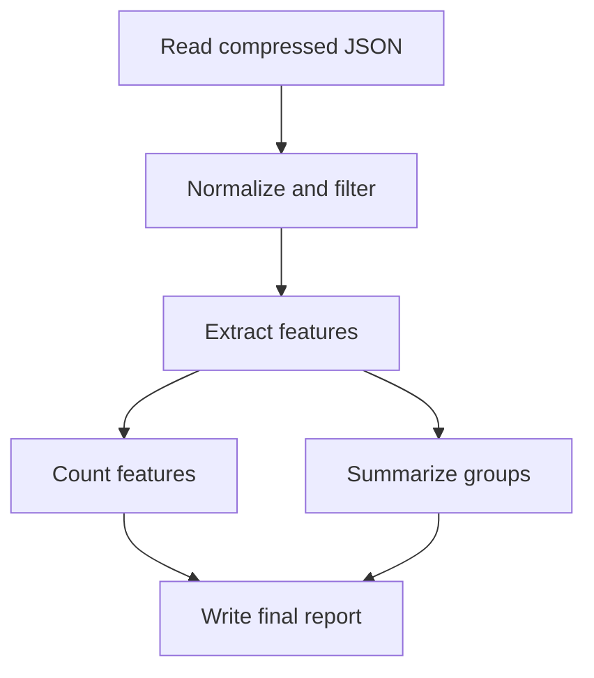

# Does selective recovery help data processing?

To **confirm whether Z3 improves results**, use the fixed ten-case protocol in
[CONFIRMATION.md](CONFIRMATION.md): fresh and disjoint document samples, seven
repetitions, strong greedy and exact knapsack DP, and completion time including
planning overhead. It performs no adaptive search for favorable cases.

For **real public data, branching pipelines, storage budgets, stronger greedy
controls, Z3 optimization, and resumable measured replays**, use
[COMPREHENSIVE.md](COMPREHENSIVE.md). The original small generated-data experiment
below remains available unchanged.

The targeted `news_dedup_progress news_dedup_reduce` experiment in that guide
adds seven real document-source partitions competing for checkpoint space. It
exports explicit greedy counterexamples only if the measured cost model and Z3
audit establish them; ordinary and reduce-phase failure scenarios remain separate.

This is a small **measured mechanism experiment**, not a claim of research
novelty or a distributed Ray benchmark. It executes real data-processing
operators on generated records, commits selected intermediate outputs, abruptly
terminates a worker process, and reconstructs the remaining computation in a new
process. No artificial computation delays or cloud resources are used.

The first question is whether selective output checkpointing improves elapsed
time over both ordinary recomputation and saving every intermediate result.
Placement is fixed. Joint placement/protection planning, Fixed-R, TorchFT, and
the previously discussed published scheduling algorithms are not used here.

## Run

From the repository root, using your existing `ray-dev` Python environment:

```bash
python gossip_benchmarks/selective_replication/data_processing/benchmark.py
```

Python 3.10+ and Linux/macOS are required. Only the Python standard library is
used. There is no Ray build or package installation step. The project owner runs
the experiment; preparing this code does not imply it has been executed or
validated by the assistant.

The default is 3 workloads x 4 policies x 4 failure conditions x 3 repetitions
= **144 measured evaluations**, plus one profiling run per workload. It stops
when done; it does not pad execution to fill a time budget. A supervising process
limits the controller and all workers to **28 minutes**, terminates their process
group on timeout, and then writes the small final report. `--max-minutes` may
lower this limit, or raise it to at most 29. Large inputs may not finish all
evaluations within the budget; a single worker also has a 120-second cap.

```bash
# Smaller complete experiment, if the default input is too slow on your host:
python gossip_benchmarks/selective_replication/data_processing/benchmark.py --documents 1000

# One workload, retaining all policies, failure conditions, and 3 repetitions:
python gossip_benchmarks/selective_replication/data_processing/benchmark.py --workloads document_minhash
```

Defaults: 4,000 documents, 96 tokens per document, 32-component MinHash signatures,
and an **assumed 10% probability of one failure**. `--failure-probability` changes
that assumption before profiling/plan selection. It is not a measured cloud
interruption rate. `--documents`, `--tokens`, `--seed`, `--repeats` (1..3),
`--workloads`, `--output`, and `--max-minutes` are available. Existing output
directories are never overwritten. The initial version does not resume partial
runs; completed observations are retained for inspection.

## Workloads

All three use the same task graph, with two consumers of the feature output:



The tasks are scheduled **serially on one worker**, including the two branches.
Its memory cache retains computed outputs until the job ends or the worker dies.
This keeps placement and concurrency out of the first mechanism comparison.

| Workload | Actual operators | Purpose |
|---|---|---|
| `log_etl` | Gzip/JSON reads, status filtering, regex normalization, tokenization, word counts, group summaries | Cheap recomputation control; copying data may not pay off |
| `document_minhash` | Same input preparation, word 3-shingles, 32 MinHash components, signature-bucket counts, group summaries | Expensive computation producing compact features; plausible positive case |
| `wide_tokens` | Same preparation, one record per token carrying its document/group/position and text context, counts, group summaries | Expanded intermediate table; serialization/storage overhead may dominate |

These are practical **operator patterns on synthetic data**, not complete
production ETL, document deduplication, or distributed analytics applications.
The MinHash stage is feature extraction and signature bucketing, not an
implementation of full near-duplicate detection. Input status filtering and text
distributions are fixed and documented in the source.

## Policies

Every policy writes the same final output to durable storage. It chooses among
the five preceding task outputs; checkpoints use pickle protocol 5, file fsync,
atomic rename, and directory fsync. Serialization and deserialization are timed.

| Policy | Intermediate outputs saved |
|---|---|
| `recompute` | None. Reconstruct missing dependencies from durable input after worker loss |
| `checkpoint_all` | All five |
| `greedy_selective` | Use measured costs to toggle one checkpoint at a time until no improvement, starting from both none and all; keep the better result |
| `optimal_selective` | Enumerate all 32 output subsets under the same measured-cost model |

The selective methods minimize modeled expected elapsed time at the supplied
failure probability. The model accounts for dependencies, shared ancestors,
surviving checkpoints, reloads, and checkpoint writes during recovery. It does
not simply add independent per-task benefits. Constant startup/restart overhead
is omitted from plan selection because it is common to all subsets under these
fixed failure conditions; measured evaluation includes it. Profiling and planning
time are saved separately and **not** charged to evaluation elapsed time. For a
one-off job, include those costs when interpreting net benefit.

Both selective policies are our small benchmark controls, **not implementations
of Han, uHEFT, Dyna, or SpotOn**. The exhaustive policy is optimal only for this
32-option measured-cost model. If greedy and exhaustive choose the same subset,
timing differences between their repeated executions are noise, not evidence of
a planning advantage. Selecting none or all is permitted and is reported honestly.

## Failure, calibration, and correctness

- One separate generated input profiles compute, save, and reload times. The
  plans are frozen before evaluation and saved in `profiles.json`.
- Three evaluation inputs use distinct seeds. For each input, every policy sees
  identical data and each of four conditions: healthy, loss after normalization,
  loss after feature extraction, and loss after counting features. The order of
  workload/repetition blocks and of policy/condition evaluations is randomized
  with a recorded seed. This is serial execution; policies do not contend with
  each other concurrently.
- A failing worker calls `os._exit(75)` immediately after the specified task and
  its selected checkpoint have completed. This loses its actual Python memory;
  the controller starts a fresh worker. No sleeps or fake recovery costs are
  used. The measured interval includes process startup, abrupt exit, restart,
  deserialization, recomputation, and checkpoint writes.
- The controller, immutable input, and checkpoint directory survive. Its task
  completion metadata identifies the remaining scheduled tasks. Their missing
  dependencies are reconstructed recursively. It does not blindly rerun every
  already-completed task; a saved downstream output can skip its ancestors.
- All outputs are compared within the complete workload/repetition block,
  including against healthy ordinary recomputation. The report includes a
  SHA-256 of the full aggregate contents, totals, and group summaries. Checkpoint
  round trips are also checked while profiling. Any mismatch aborts the run.
- Failure positions are predefined and used in planning and evaluation. **Only
  inputs and execution timings are separate, not the failure distribution.**
  Crashes within a running task or checkpoint write are not covered. Boundary
  failures favor completed checkpoints relative to arbitrary interruption times.

## Outputs and interpretation

The command prints a unique `ray_gcp_results/data-processing-recovery/...` path
and progress every 15 seconds. Read `summary.md`, and share **`analysis.zip`**.
That archive includes raw observations and events, profiles and chosen subsets,
source snapshots, input seeds, timing aggregates, status, and diagnostic logs.
Large input/checkpoint payloads are excluded. Successful working directories are
removed automatically; failed/interrupted working files remain for diagnosis.

The main metrics are measured healthy time, mean completion time with a failure,
and expected time under the stated assumption:

`expected_time(q) = (1-q) * healthy_time + q * mean_failure_time`.

The three failure positions have equal conditional weights. This mixture does
not model a constant per-second hazard: slower policies are not assigned higher
failure probability. We report each condition separately in `runs.csv` and all
raw events in `runs.jsonl`. `recovery_s` measures the interval from detecting the
failed worker to completion; it includes fresh process startup and remaining
useful computation, not just replay overhead. `recompute_s` isolates repeated
task computations; checkpoint bytes count writes including any recovery writes.

The summary compares each selective method with both recomputation and
checkpoint-all, and compares exhaustive with greedy. Percentage differences are
paired by input/repetition. With all three repetitions it supplies exploratory
95% Student-t intervals (df=2) for the paired percentage gains. Three repetitions
are weak evidence: intervals assume independent approximately normal differences,
and multiple comparisons are not corrected. They do not quantify uncertainty in
cloud failure rates or establish broad statistical superiority.

Break-even statements vary the assumed probability **with the selected plans
held fixed**, using measured mean healthy/failure times. A recovered run being
faster alone is not enough: healthy-run overhead may cancel it for rare failures.
Only complete matched blocks enter aggregates, so timeouts do not silently give
different policies different case sets. Partial results are clearly labeled.

Treat a repeatable gain over both controls, at a defensible failure probability,
as evidence that the mechanism is useful **for that pipeline and environment**.
If a simple greedy policy matches exhaustive selection, the useful result is
selective checkpointing, not a unique benefit of sophisticated optimization.
Report the cheap and large-intermediate controls even if they lose or tie.

Local disk I/O and the OS page cache are real but not network/object-store I/O.
There is no multi-node data placement, network contention, VM provisioning,
billing model, controller failure, or head-node recovery. Measured times are
single-host Python implementation times, not Spark/Ray performance predictions.
If the mechanism passes, the next experiment needs real data, a distributed
runtime's native recovery baseline, and the relevant published selective method.

Useful prior work (not reproduced here): Han et al., *Checkpointing Workflows
for Fail-Stop Errors* (2018), https://doi.org/10.1109/TC.2018.2801300; Zaharia et
al., *Resilient Distributed Datasets: A Fault-Tolerant Abstraction for In-Memory
Cluster Computing* (2012), https://www.usenix.org/conference/nsdi12/technical-sessions/presentation/zaharia.
